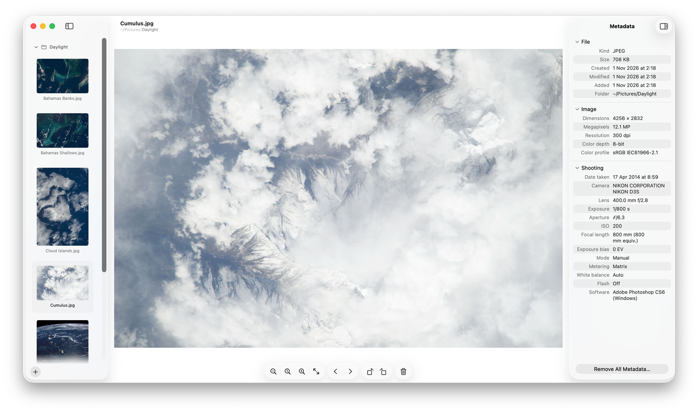

<p align="center"></p>
<h1 align="center">Pixomancy</h1>
<p align="center">A fast photo viewer for macOS.</p>
<p align="center">
  <a href="https://github.com/yulia-ivashko/pixomancy/releases/latest"></a>
  <a href="https://github.com/yulia-ivashko/pixomancy/releases"></a>
  
</p>

<picture>
  <source media="(prefers-color-scheme: dark)" srcset="docs/screenshot-dark.png">
  
</picture>

Open one photo and flip through every photo in its folder with the arrow keys, see everything the file knows about it, and rename, tag, move or clean it up without leaving the window.

## Browsing

- ← → step through the folder, in Finder's order, wrapping at the ends
- Open a folder, or add more folders (⇧⌘O) and step through all of them in turn
- Sidebar with the folders' photos: thumbnails, thumbnails and names, or a list
- Click any folder in the path under the photo's name to open it; back and forward take you where you were, like in Finder
- New, deleted and edited files show up by themselves, also when another app saves over the photo you're looking at

## Viewing

- The window takes the photo's shape, like Preview, and comes back where you left it
- Zoom in and out, actual size, fit to window or screen, pinch and ⌘-scroll zoom, drag to pan
- Slideshow (F5) and full screen

## Changing the file

- Click the photo's name in the title to rename it, add Finder tags or move it to another folder, as in Preview
- Rotate left and right, saved to the file (JPEG and HEIC without re-compression)
- Move to Trash, print, copy, copy path (⌥), set as wallpaper
- Open in Preview, for signing, markup and small edits

## Metadata

- Metadata sidebar (⌘I), laid out like Finder's Get Info, with sections you can fold:
  - **Description**: title, caption, keywords, author, credit, copyright, rating and colour label
  - **File**: kind, size, created, modified, added, folder, tags, last opened, where it was downloaded from
  - **Image**: dimensions, megapixels, resolution, colour depth and profile
  - **Shooting**: date taken, camera, lens, exposure, aperture, ISO, focal length, exposure bias, mode, metering, white balance, flash, software, Live Photo, HDR and Portrait
  - **Location**: place name, coordinates, altitude, direction and speed, with Open in Maps
- Long values fold to two lines
- **Remove All Metadata**: camera, location, download source, tags and every other detail, in one go

English and Ukrainian, following the system language. Light and dark.

Native Swift (AppKit + SwiftUI), Apple silicon, macOS 26 or later.

## Install

Download `Pixomancy-<version>.zip` from [Releases](https://github.com/yulia-ivashko/pixomancy/releases/latest), unzip it and move Pixomancy to Applications. The current builds are not notarised yet: the first time you open Pixomancy, macOS says it can't verify it. Open System Settings → Privacy & Security, click Open Anyway, and from then on it opens as usual.

## Build

```sh
./build.sh
```

The app lands in `build/Pixomancy.app`. To open photos with it by default: Finder → right-click a photo → Get Info → Open with → Pixomancy → Change All.
